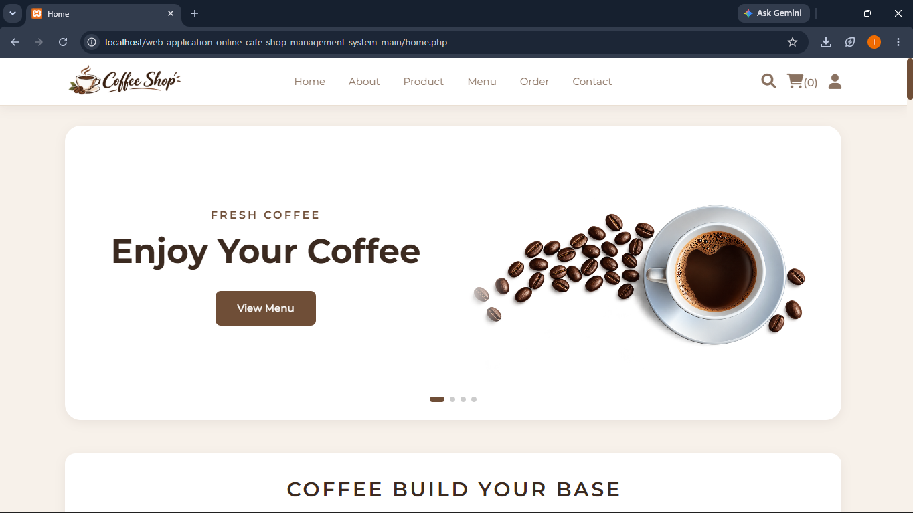
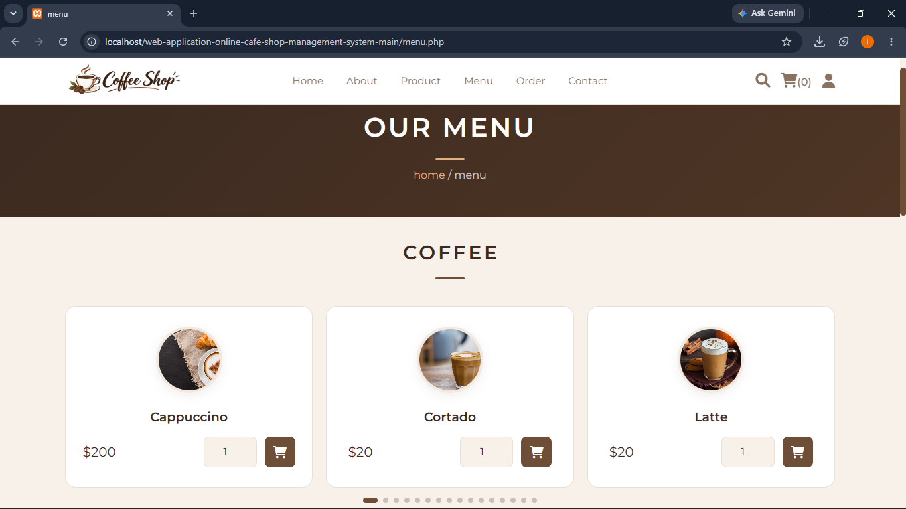
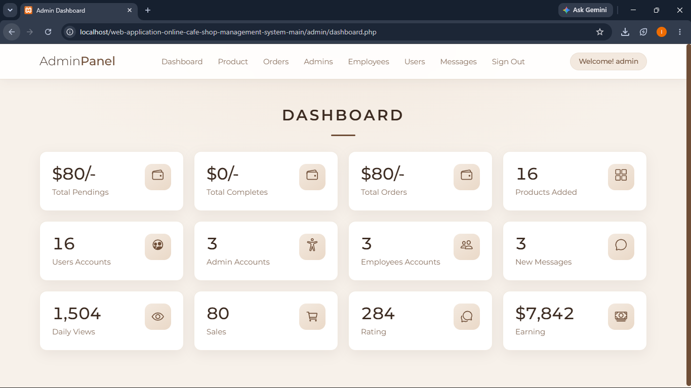
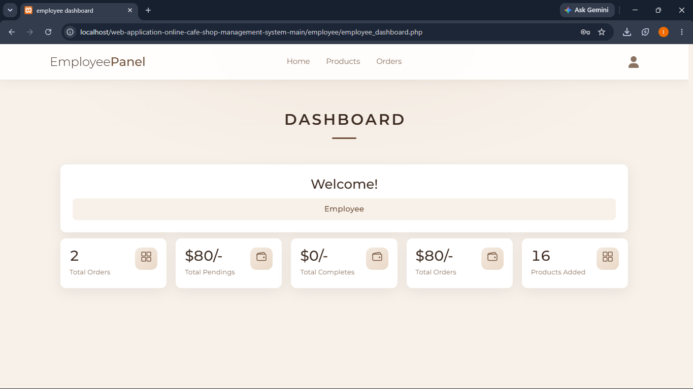

# Online Cafe Shop Management System

Web application for an online cafe shop. Customers can order food and drinks online, while the admin and employees manage products, orders, accounts and messages.

## Features

- Register and login for User, Admin and Employee
- Product management: add, update, delete (categories: coffee, main dish, drinks, desserts)
- Search products by name and browse by category
- Cart, checkout (cash on delivery / bkash) and order history
- Order management: update payment status (pending / completed) and delete orders
- Account management: add and delete admin, employee and user accounts
- Contact form for customer messages
- Dashboard with order, product, account and message summaries

## Screenshots

### Home Page User

### Menu Page

### Home Page Admin

### Home Page Employee

## Tech Stack

- PHP (PDO), MySQL
- HTML, CSS, JavaScript
- XAMPP (Apache + MySQL)
- Swiper, Font Awesome, Ionicons

## Setup

1. Install XAMPP and start **Apache** and **MySQL**.
2. Open http://localhost/phpmyadmin/ and create a database named `food_db`.
3. Import `food_db.sql` into `food_db`.
4. Put this project in `C:\xampp\htdocs` and rename the folder to `cafe_shop`.

## Run

- User site: http://localhost/cafe_shop
- Admin panel: http://localhost/cafe_shop/admin/admin_login.php
- Employee panel: http://localhost/cafe_shop/employee/employee_login.php

## Access Rights

- **Admin** (`/admin/admin_login.php`): manage products, orders, admin / employee / user accounts and messages.
- **Employee** (`/employee/employee_login.php`): manage products and orders.
- **User** (`/login.php`): browse the menu, use the cart, checkout, view orders, and manage profile and address.

Visitors (not logged in) can browse the menu and send a message, but must log in to add items to the cart.

## Project Structure

- `admin/`: admin panel (dashboard, products, orders, accounts, messages)
- `employee/`: employee panel (dashboard, products, orders)
- `components/`: shared parts (headers, footer, `connect.php`, `add_cart.php`, logout)
- `css/`: stylesheets
- `js/`: JavaScript files
- `images/`: website images
- `uploaded_img/`: uploaded product images
- `home.php`, `about.php`, `product.php`, `menu.php`, `category.php`, `search.php`, `quick_view.php`: public pages
- `cart.php`, `checkout.php`, `orders.php`: cart, checkout and order history
- `login.php`, `register.php`, `profile.php`, `update_profile.php`, `update_address.php`: user account pages
- `contact.php`: contact form
- `food_db.sql`: database script

## Database

Database name: `food_db`

- `admin`, `employee`, `users`: account data
- `products`, `cart`, `orders`: shop data
- `messages`: contact messages
- `rating`: review table (not used in the interface yet)